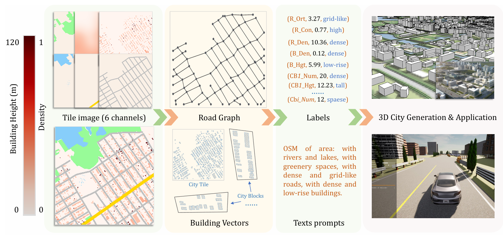
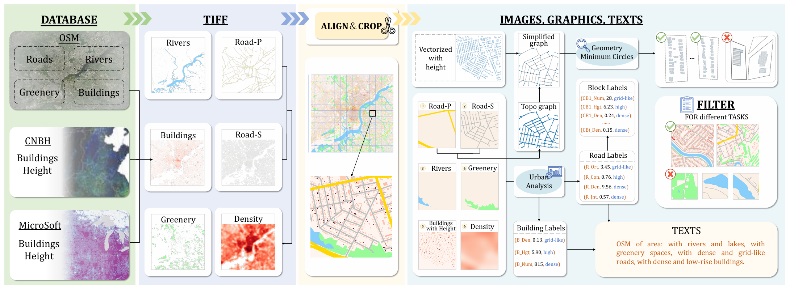

# RoBus_Dataset

Official repository for the arXiv preprint "[RoBus: A Multimodal Dataset for Controllable Road Networks and Building Layouts Generation](https://arxiv.org/abs/2407.07835)".

## Introduction

Automated 3D city generation, focusing on road networks and building layouts, is in high demand for applications in urban design, multimedia games and autonomous driving simulations.
The surge in generative AI models facilitates the design of city layouts in recent years.
However, the lack of high-quality datasets and benchmarks hinders the progress of these data-driven methods in generating road networks and building layouts.
Furthermore, few studies consider urban characteristics, which are generally analyzed using graphics and are crucial for practical applications, to control the generative process.
To alleviate these problems, we introduce a multimodal dataset with accompanying evaluation metrics for controllable generation of **Ro**ad networks and **Bu**ilding layout**s** (**RoBus**), which is the first and largest open-source dataset in city generation so far.
RoBus dataset is formatted as images, graphics and texts, with $72,400$ paired samples that cover around $80,000 \, km^2$ globally.
We analyze the RoBus dataset statistically and validate the effectiveness against existing road networks and building layouts generation methods.
Additionally, we design new baselines that incorporate urban characteristics, such as road orientation and building density, in the process of generating road networks and building layouts using the RoBus dataset, enhancing the practicality of automated urban design.



## Repository layout

| Path | Role |
| --- | --- |
| `data_preperation/` | Build the RoBus dataset from OSM and building sources (raster tiles, topology, statistics, prompts). |
| `csv2xodr/` | Convert generated road graphs into formats used by SUMO and CARLA (CSV → OSM → OpenDRIVE / SUMO). |
| `CycleGAN-pix2pix/` | Copied from the original [pytorch-CycleGAN-and-pix2pix](https://github.com/junyanz/pytorch-CycleGAN-and-pix2pix) project. See that folder's README for training and testing. |
| `read_tiff.py` | Visualize multi-channel GeoTIFF samples as RGB images. |

Most scripts read and write relative paths such as `./data` and `./dataset_roads`. Edit the paths in each file's `__main__` block (or place data in those folders) before running.

## Dataset generation pipeline



Run the following from `data_preperation/` unless noted otherwise.

### 1. OSM and building layers → rasters

Process each city/region OSM extract into aligned raster layers.

1. **`main_osm2roads.py`** — Parse OSM roads, write classed GeoJSON, then rasterize primary (`p1`) and secondary (`p2`) networks.
2. **`main_osm2landuse.py`** — Parse OSM land use (water, woods, etc.) and rasterize. Can also clip water polygons from a shapefile.
3. **`main_gen_road_density.py`** — Build a road-density heatmap from the road rasters / GeoJSON.
4. **`main_buildings_cn.py`** — Extract buildings in China from OSM, attach heights from a local height raster, write GeoJSON and rasterize.
5. **`main_building_oversea.py`** — Extract buildings outside China from Microsoft building footprints and rasterize.
6. **`main_osm2poi.py`** — Optional. Export POIs such as bus stops from OSM to GeoJSON.
7. **`batch_align_crop.py`** — Align all raster channels to a common extent and crop tiles (e.g. 512×512).

After this stage you should have per-region folders under `./dataset_roads/<region>/` with roads, land use, density, buildings, and `cropped_images/`.

### 2. Tiles → topology, statistics, and text prompts

8. **`main_gen_road_topo.py`** — Skeletonize each tile's road image and export a NetworkX topology (`.gpickle`). `main_gen_road_topo_cpython.py` is a CPython-oriented variant of the same step.
9. **`main_cal_tile_statics.py`** — Compute per-tile urban metrics (road density, orientation, junction density, building density/height, etc.) and save JSON/NumPy summaries.
10. **`main_cal_boundary_statics.py`** — Compute block-level (urban-block) building statistics from extracted block polygons.
11. **`main_extract_building_per_tile.py`** — Find road-network cycles as urban blocks and collect the buildings inside each block.
12. **`main_filter_tiles_for_tasks.py`** — Keep tiles that have enough roads / buildings for generation tasks; write name lists.


### 3. Visualize and evaluate

- **`../read_tiff.py`** (repo root) — Render GeoTIFF channels (roads, water, woods, buildings, density) to PNG.
- **`main_read_tiles.py`** — Visualize cropped tile channels (useful as diffusion / pix2pix inputs).
- **`main_read_gpickle.py`** — Inspect saved road-topology graphs.
- **`main_eval_distribution.py`** — Compare generated vs. real images (FID-style / overlap / geometric constraint checks).
- **`inception_download.py`** — Download the Inception checkpoint used by evaluation.

### 4. Helper modules (`data_preperation/scripts/`)

These are libraries imported by the `main_*.py` scripts; you rarely run them alone.

| File | Purpose |
| --- | --- |
| `osm_parsing.py` | OSM → GeoJSON for roads, buildings, land use, orientation, density, POIs. |
| `vec2raster.py` | Vector (GeoJSON) → GeoTIFF rasterization. |
| `tiff_operation.py` | CRS conversion, clip, crop, merge, and reproject GeoTIFFs. |
| `trace_skeleton.py` | Binary road image → polylines ([skeleton-tracing](https://github.com/LingDong-/skeleton-tracing)); preferred over `sknw/`. |
| `extract_topo_layout.py` | Skeleton + (modified) `sknw` → topology / layout graphs. |
| `calculate_network.py` | Network metrics on a topology graph. |
| `visualization.py` | Plot topologies and metric histograms. |
| `cal_chamfer_distance.py` | Chamfer distance between two image sets. |
| `basic_maths.py` | Small geometry helpers. |

## Convert graphs to SUMO and CARLA (`csv2xodr/`)

This folder turns a generated road topology into files that **SUMO** and **CARLA** can load: numbered road CSVs, OSM, OpenDRIVE (`.xodr`), and SUMO net/route XML.

Run from `csv2xodr/` unless noted.

1. **`points2csv.py`** — Partition a topology graph into numbered roads and write `{scene}_roads.csv` plus `{scene}_attributes.csv`. Two modes: (a) resample points, reconnect, simplify, then split into roads; (b) split the existing graph into roads only.
2. **`csv2nx.py`** — Load those CSVs into NetworkX for a quick visual check.
3. **`csv2osm.py`** — Convert the two CSVs to an `.osm` file and a projection string `.txt`.
4. **`osm2carla/main.py`** — One-shot OSM → OpenDRIVE (`.xodr`) → SUMO `*.net.xml` + `*.rou.xml`. Set `CARLA_ROOT` first (defaults to `~/carla`):
   ```bash
   export CARLA_ROOT=/path/to/carla
   cd osm2carla
   python main.py
   ```

### Optional / related files

- **`graph2geojson.py`** — Export a topology (or generated roads) to GeoJSON polygons / OSM for GIS preview.
- **`trans_label_to_crs_building.py`** — Place generated building layouts into geographic coordinates using a reference GeoTIFF.
- **`edge_construction.py`** — Helpers used by `points2csv.py` (keypoint graph, MST, reconnect degree-1 nodes).

### Manual OSM → OpenDRIVE → SUMO (Ubuntu)

If you prefer step-by-step conversion instead of `osm2carla/main.py`:

1. OSM → OpenDRIVE (needs CARLA's Python API):
   ```bash
   python c_osm_to_xodr.py -i roads.osm -o roads.xodr --proj_string "+proj=tmerc +lat_0=30.5006 +lon_0=112.1"
   ```
   Paste the projection string produced by `csv2osm.py` into `--proj_string`.
2. OpenDRIVE → SUMO net:
   ```bash
   python osm2carla/Sumo/util/netconvert_carla.py roads.xodr
   ```
3. Random trips for SUMO:
   ```bash
   python osm2carla/randomTrips.py -n net.net.xml -r net.rou.xml
   ```

Install SUMO on Ubuntu:

```bash
sudo add-apt-repository ppa:sumo/stable
sudo apt-get update
sudo apt-get install sumo sumo-tools sumo-doc
export SUMO_HOME=/usr/share/sumo/
```

## CycleGAN-pix2pix

The `CycleGAN-pix2pix/` directory is copied from the original [pytorch-CycleGAN-and-pix2pix](https://github.com/junyanz/pytorch-CycleGAN-and-pix2pix) repository and is used as a baseline for paired image-to-image translation (for example land-use / density → roads or buildings). Follow that project's own README, `docs/tips.md`, and `train.py` / `test.py` flags.

## Visualize data samples

```shell
python read_tiff.py
```


## Proposed datasets

Please visit the following links to download the datasets:

- Europe: https://pan.baidu.com/s/17SB8pjRMVwl_nylgq0FeJg
- United States: https://pan.baidu.com/s/1kB61uz_sjkTrG0YB_KIQXg
- Australia: https://pan.baidu.com/s/10JuCZB1GoRwd1V0zRXXP7g

To obtain the extraction codes, please email tourlics@foxmail.com and include your institution in the message.

For convenience, the datasets are provided as large TIFF files. You can crop them using the scripts in this repository.
